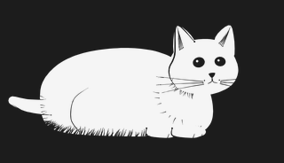
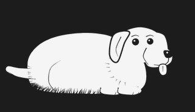
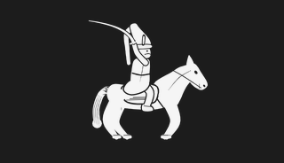
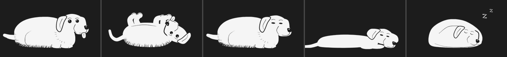
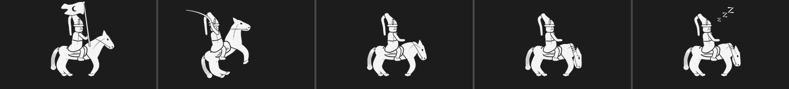
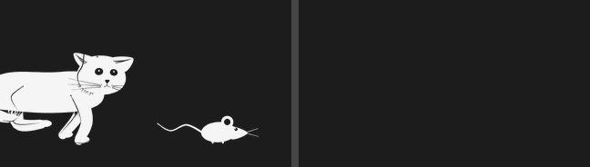
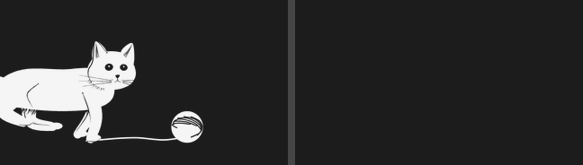
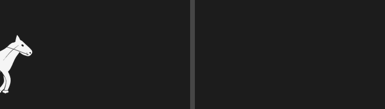

# Pati – kilit ekranında yaşayan karakterler

iPhone kilit ekranına (saatin altındaki satıra) eklenen hareketli karakter widget'ları.
Uygulama **Expo (React Native)** ile yazıldı, widget ise iOS'un zorunlu kıldığı şekilde **SwiftUI/WidgetKit** ile. İkisi tek projede duruyor ve **Mac olmadan EAS Build ile bulutta** derleniyor.

### Karakterler

| Kedi | Köpek | Atlı Yeniçeri |
|---|---|---|
|  |  |  |
|  |  |  |

### Panorama: 4 kareyi kaplayan sahneler





| Karakter | Tek widget | Panorama (4 kare) |
|---|---|---|
| Kedi | Kuyruk sallama, Uykuda nefes, Yuvarlanma | Yürüyüş, Fare kovalama, Yumak kovalama |
| Köpek | Kuyruk sallama, Uykuda nefes, Yuvarlanma | Yürüyüş, Top getirme |
| Atlı Yeniçeri | Nöbet, Savaş (kılıç + şaha kalkma) | Sefere gidiş (sancakla), Hücum |

> Önizlemeler hızlandırılmıştır. Gerçek widget saniyede 1 kare oynar.

iOS kilit ekranında saatin altındaki satır en fazla iki dikdörtgen widget alır; tek bir widget satırın tamamına yayılamaz. Panorama sahneleri bu yüzden 4000 birimlik bir tuvalde çizilip iki fonta bölünür: iki "Canlı Pati" ekleyip birini **Panorama – sol parça**, diğerini **sağ parça** yaparsın. İkisi aynı sistem sayacını kullandığı için kareler aynı anda değişir ve karakter bir widget'tan diğerine geçer.

## Mac olmadan iPhone'a kurulum

Gereken: Windows/Linux/Mac fark etmez, Node.js 20+, bir [Expo hesabı](https://expo.dev/signup) ve **ücretli Apple Developer Program üyeliği** (yıllık 99 $). Widget içeren bir uygulamayı Mac'siz imzalayıp telefona yüklemenin tek yolu bu.

```bash
git clone https://github.com/ramazan29arslan/widget.git
cd widget
npm install
npm install -g eas-cli
eas login
```

1. `app.json` içinde `ios` bölümüne Apple Team ID'ni ekle: `"appleTeamId": "ABCDE12345"` (developer.apple.com → Membership details).
2. iPhone'unu kaydet: `eas device:create` → çıkan bağlantıyı iPhone'da aç, profili yükle.
3. Derle: `eas build -p ios --profile preview`
   - EAS, Apple hesabına giriş ister; sertifikaları, App Group'u ve widget için gereken her şeyi kendisi oluşturur.
   - 15–25 dakika sonra bir QR kod / bağlantı verir. iPhone'da açıp uygulamayı yükle.
4. iPhone'da **Ayarlar → Gizlilik ve Güvenlik → Geliştirici Modu**'nu aç (ilk kurulumda istenir).
5. Kilit ekranına basılı tut → **Özelleştir** → **Kilit Ekranı** → saatin altındaki alana dokun → **Pati**.

App Store / TestFlight için: `eas build -p ios --profile production` ve ardından `eas submit -p ios`.

> Expo Go ile yalnızca uygulama ekranları açılır; widget ve App Group bağlantısı Expo Go'da çalışmaz. Widget için mutlaka EAS ile derlenmiş sürüm gerekir.

## İki widget türü

**Canlı Pati:** Saniyede bir kare oynayan 10 karelik döngü. Widget ayarlarından karakter, animasyon ve yerleşim (tek / panorama sol / panorama sağ) seçilir. "Otomatik" seçilirse klip ruh haline göre değişir (uykuluyken nefes alır, akşam yumak kovalar).

**Ruh Hali Pati:** Saate, şarja ve şarj durumuna göre poz değiştirir.

| Durum | Poz |
|---|---|
| 00–06 | Uyuyor |
| 06–08, 13–15, 22–24 | Uykulu |
| 17–20 | Oyuncu |
| Şarjda | Uyuyor (şekerleme) |
| Pil < %20 | Yorgun, yere serilmiş |
| Diğer saatler | Uyanık |

Ruh hali uygulamadan **elle de seçilebilir**; "Otomatik"e dönünce yukarıdaki kurallar geçerli olur. Kurallar iki yerde aynı tutulur: `targets/widget/Mood.swift` (widget) ve `src/mood.ts` (uygulama).

## Animasyon nasıl çalışıyor?

Kilit ekranı widget'ları sürekli animasyon oynatamaz, ama sistemin sayaç metni (`Text(date, style: .timer)`) her saniye kendiliğinden güncellenir. Bu projede:

1. Her animasyon klibi özel bir **font**tur. `0`–`9` rakamları 10 karenin çizimleridir.
2. Fontta bir OpenType `calt` kuralı var: ardından başka rakam veya `:` gelen her rakam, genişliği 0 olan boş bir glife dönüşür.
3. Sayaç `1:23:45` yazdığında ekranda yalnızca son hane (`5`) görünür, yani 5. kare. Bir saniye sonra 6. kare gelir.

Pozlar da aynı yöntemle çizilir: poz fontunda `a`, `s`, `z`, `t`, `p` harfleri birer pozdur. Uygulama aynı fontları `expo-font` ile yükleyip önizleme gösterir.

> ⚠️ Bu yöntem resmi bir animasyon API'si değildir. Gerçek cihazda test edilmeli ve her yeni iOS sürümünde tekrar kontrol edilmelidir. Ruh Hali widget'ı tamamen standart API'lerle çalışır.

## Uygulama ↔ widget iletişimi

`@bacons/apple-targets` paketindeki `ExtensionStorage`, App Group (`group.com.ramazan29arslan.pati`) üzerinden veri yazar:

| Anahtar | Yazan | Anlamı |
|---|---|---|
| `reactToBattery` | Uygulama (anahtar) | 1/0: şarja tepki ver |
| `batteryPercent` | Uygulama (expo-battery) | Son pil yüzdesi, widget okuyamazsa yedek |
| `batteryCharging` | Uygulama | 1/0 |
| `moodOverride` | Uygulama (ruh hali seçimi) | "awake", "sleepy"... yoksa otomatik |

Bundle ID'yi değiştirirsen App Group adını üç yerde güncelle: `app.json`, `src/widgetBridge.ts`, `targets/widget/SharedSettings.swift`.

## Görselden karakter (önerilen)

Gerçekçi çizimler için PNG kareleri ya da sprite sheet'i `Tools/fontgen/art/<karakter>/<klip>/` klasörüne koy. `build_fonts.py`, bunları potrace ile vektöre çevirip widget fontu yapar. Ayrıntılar ve yapay zekâ istem örnekleri için [Tools/fontgen/art/README.md](Tools/fontgen/art/README.md) dosyasına bak.

## Yeni karakter eklemek (kodla çizim)

```bash
cd Tools/fontgen
pip install -r requirements.txt
cp characters/cat.py characters/tavsan.py   # ID, NAME, çizimler, CLIPS, MOOD_CLIPS, POSES'u düzenle
python3 build_fonts.py   # fontları + Swift ve TypeScript kataloglarını üretir
python3 test_fonts.py    # sayaç testleri + docs/preview önizlemeleri
```

Çizimler `sketch.py` ile yapılır: `fill` beyaz ekler, `cut` siyah kalem çizgisi oyar (göz, bıyık, tüy taraması). Katmanlar sırayla uygulanır.

Kurallar:
- Her klip tam **10 kare** olmalı. `CLIPS` girdisi: `"id": ("Başlık", kare_üretici, panorama_mı)`.
- Tek widget tuvali 2000 × 1000, panorama tuvali 4000 × 1000 font birimidir. Zemin y≈30.
- Kilit ekranı tek renk gösterir: beyaz dolgu + siyah oyuk çizgiler.
- `MOOD_CLIPS`: ruh hali → "Otomatik" modda oynatılacak klip.
- `POSES`: `a s z t p` harfleri (uyanık, uykulu, uyuyor, yorgun, oyuncu).
- Sadece bir karakteri yeniden üretmek için: `python3 build_fonts.py cat`

## Klasörler

```
App.tsx, src/          Expo uygulaması (galeri, canlı önizleme, ayarlar)
targets/widget/        SwiftUI widget kodu ve fontlar (apple-targets ile Xcode'a eklenir)
Tools/fontgen/         Çizimden font üreten ve test eden Python araçları
docs/preview/          Üretilen önizlemeler
```

`ios/` klasörü depoda tutulmaz; `npx expo prebuild` ya da EAS Build her seferinde yeniden üretir.

## Yol haritası

- [ ] Gerçek cihazda font/sayaç yönteminin doğrulanması
- [ ] SVG karelerden font üretimi (tasarımcı çizimleri için)
- [x] Köpek ve atlı yeniçeri
- [x] Panorama (4 kare) ve elle ruh hali seçimi
- [ ] Yeni karakterler: tavşan, kurbağa, bulut, hayalet
- [ ] Hava durumu ve konuma göre pozlar (WeatherKit)
- [ ] Ücretli karakter paketleri
