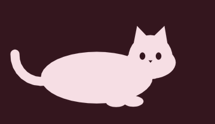
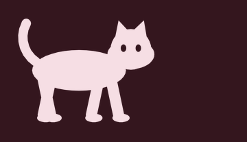
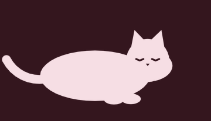
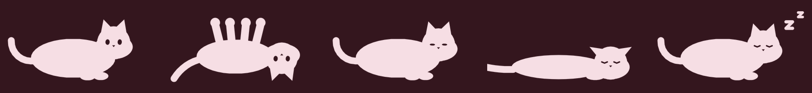

# Pati – kilit ekranında yaşayan karakterler

iPhone kilit ekranına (saatin altındaki satıra) eklenen hareketli karakter widget'ları.

| Kuyruk sallama | Yürüyüş | Uykuda nefes | Yuvarlanma |
|---|---|---|---|
|  |  |  |  |

Ruh hali pozları (uyanık, oyuncu, uykulu, yorgun, uyuyor):



> Önizlemeler hızlandırılmıştır. Gerçek widget saniyede 1 kare oynar.

## İki widget türü

**Canlı Pati:** Saniyede bir kare oynayan 10 karelik döngü. Ayarlardan karakter ve animasyon seçilir. "Otomatik" seçilirse klip ruh haline göre değişir (uykuluyken nefes alır, akşam yuvarlanır).

**Ruh Hali Pati:** Saate, şarja ve şarj durumuna göre poz değiştirir.

| Durum | Poz |
|---|---|
| 00–06 | Uyuyor |
| 06–08, 13–15, 22–24 | Uykulu |
| 17–20 | Oyuncu |
| Şarjda | Uyuyor (şekerleme) |
| Pil < %20 | Yorgun, yere serilmiş |
| Diğer saatler | Uyanık |

Kurallar `Shared/Mood.swift` içinde.

## Animasyon nasıl çalışıyor?

Kilit ekranı widget'ları sürekli animasyon oynatamaz, ama sistemin sayaç metni (`Text(date, style: .timer)`) her saniye kendiliğinden güncellenir. Bu projede:

1. Her animasyon klibi özel bir **font**tur. `0`–`9` rakamları 10 karenin çizimleridir.
2. Fontta bir OpenType `calt` kuralı var: ardından başka rakam veya `:` gelen her rakam, genişliği 0 olan boş bir glife dönüşür.
3. Sayaç `1:23:45` yazdığında ekranda yalnızca son hane (`5`) görünür, yani 5. kare. Bir saniye sonra 6. kare gelir.

Pozlar da aynı yöntemle çizilir: poz fontunda `a`, `s`, `z`, `t`, `p` harfleri birer pozdur.

> ⚠️ Bu yöntem resmi bir animasyon API'si değildir. Gerçek cihazda test edilmesi, her yeni iOS sürümünde tekrar kontrol edilmesi gerekir. Ruh Hali widget'ı tamamen standart API'lerle çalışır.

## Kurulum

Gereken: Mac, Xcode 15+, iOS 17+ iPhone, ücretsiz ya da ücretli Apple Developer hesabı.

```bash
brew install xcodegen
git clone https://github.com/ramazan29arslan/widget.git
cd widget
xcodegen            # Pati.xcodeproj oluşturur
open Pati.xcodeproj
```

1. Xcode'da her iki hedef (Pati, PatiWidgetExtension) için **Signing & Capabilities** → Team seç.
2. Bundle ID'ler başkasına aitse `project.yml` içindeki `com.ramazan29arslan` önekini ve App Group adını değiştir (`Shared/SharedSettings.swift` içindeki `appGroupID` ile aynı olmalı), sonra `xcodegen` komutunu tekrar çalıştır.
3. iPhone'u bağla, **Pati** şemasıyla çalıştır.
4. Kilit ekranına basılı tut → **Özelleştir** → **Kilit Ekranı** → saatin altındaki alana dokun → **Pati**.

## Yeni karakter eklemek

```bash
cd Tools/fontgen
pip install -r requirements.txt
cp characters/cat.py characters/kopek.py   # ID, NAME, çizimler, CLIPS, POSES'u düzenle
python3 build_fonts.py   # fontları ve Shared/CharacterCatalog.generated.swift'i üretir
python3 test_fonts.py    # sayaç testleri + docs/preview önizlemeleri
```

Kurallar:
- Her klip tam **10 kare** olmalı.
- Tuval 2000 × 1000 font birimidir (2:1, kilit ekranı dikdörtgen widget'ına uygun).
- Kilit ekranı tek renk gösterdiği için çizimler siluet ya da çizgi stilinde olmalı. Delikler (göz, burun) `hole` ile oyulur.
- Ruh hali pozlarında `a s z t p` harflerini kullan. Eksik poz olursa ilk poz gösterilir.
- Uygulama ve widget, paketteki tüm `.ttf` dosyalarını çalışma anında kaydeder; Info.plist'e dokunmak gerekmez.

## Klasörler

```
App/                 Ana uygulama (galeri, önizleme, ayarlar)
WidgetExtension/     Canlı Pati ve Ruh Hali Pati widget'ları, ayar intent'leri
Shared/              Karakter modeli, ruh hali motoru, fontlar (iki hedef de kullanır)
Tools/fontgen/       Çizimden font üreten ve test eden Python araçları
docs/preview/        Üretilen önizlemeler
```

## Yol haritası

- [ ] Gerçek cihazda font/sayaç yönteminin doğrulanması
- [ ] SVG karelerden font üretimi (tasarımcı çizimleri için)
- [ ] Yeni karakterler: köpek, kurbağa, bulut, hayalet
- [ ] Hava durumu ve konuma göre pozlar (WeatherKit)
- [ ] Ücretli karakter paketleri (StoreKit)
